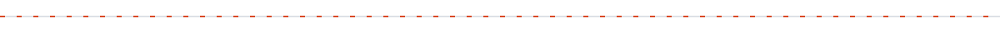
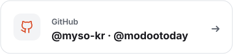
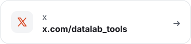
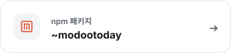
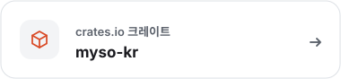
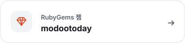

<!-- GENERATED FILE - edit src/ instead (node build/build.mjs) -->

<h1><a href="https://github.com/myso-kr"><picture><source media="(prefers-color-scheme: dark)" srcset="https://raw.githubusercontent.com/myso-kr/myso-kr/main/assets/hero-dark.svg"></picture></a></h1>

<picture><source media="(prefers-color-scheme: dark)" srcset="https://raw.githubusercontent.com/myso-kr/myso-kr/main/assets/status-dark.svg"></picture>

모두의오늘의 서비스와 도구를 만들고 운영합니다. 아래에서 하는 일, 운영 중인 서비스, 최근 작업을 볼 수 있습니다.

<picture><source media="(prefers-color-scheme: dark)" srcset="https://raw.githubusercontent.com/myso-kr/myso-kr/main/assets/divider-flow-dark.svg"></picture>

<h2><picture><source media="(prefers-color-scheme: dark)" srcset="https://raw.githubusercontent.com/myso-kr/myso-kr/main/assets/sec-maker-dark.svg"></picture></h2>

<a href="https://modoo.today"><picture><source media="(prefers-color-scheme: dark)" srcset="https://raw.githubusercontent.com/myso-kr/myso-kr/main/assets/maker-dark.svg"></picture></a>

버그나 아이디어는 각 저장소의 Issues에 남겨 주세요.

<h2><picture><source media="(prefers-color-scheme: dark)" srcset="https://raw.githubusercontent.com/myso-kr/myso-kr/main/assets/sec-services-dark.svg"></picture></h2>

서비스별 자세한 소개와 저장소는 <a href="https://github.com/modootoday" title="모두의오늘 GitHub 조직 프로필">modootoday 조직 프로필</a>에 있습니다.

<table width="100%">
<thead><tr><th scope="col" width="28%" align="left">서비스 </th><th scope="col" width="20%" align="left">대상 </th><th scope="col" width="52%" align="left">한 줄 소개 </th></tr></thead>
<tbody>
<tr><td width="28%"><a href="https://modoo.today" title="모두의오늘 웹사이트"><b>모두의오늘</b></a> modoo.today</td><td width="20%">창작자</td><td width="52%">브랜드 콘텐츠를 운영하는 통합 AI OS</td></tr>
<tr><td width="28%"><a href="https://biz.modoo.today" title="모두의오늘 비즈 웹사이트"><b>모두의오늘 비즈</b></a> biz.modoo.today</td><td width="20%">사업자·대행사</td><td width="52%">브랜드의 오늘을, 근거가 남는 운영 결과로.</td></tr>
<tr><td width="28%"><a href="https://skills.modoo.today" title="모두의오늘 스킬 웹사이트"><b>모두의오늘 스킬</b></a> skills.modoo.today</td><td width="20%">AI 사용자</td><td width="52%">87개 분야 508개 스킬 중 필요한 것만 읽는 MCP 커넥터</td></tr>
<tr><td width="28%"><a href="https://datalab.tools" title="데이터랩툴즈 헬퍼 웹사이트"><b>데이터랩툴즈 헬퍼</b></a> datalab.tools</td><td width="20%">창작자·마케터</td><td width="52%">보던 화면을 분석 도구로 바꾸는 브라우저 헬퍼</td></tr>
<tr><td width="28%"><a href="https://codex.datalab.tools" title="SOLA Codex 웹사이트"><b>SOLA Codex</b></a> codex.datalab.tools</td><td width="20%">데이터·분석</td><td width="52%">콘텐츠 품질 점수를 계산하는 방식을 공개한 문서</td></tr>
<tr><td width="28%"><a href="https://ink.minago.blog/en" title="Minago Ink 웹사이트"><b>Minago Ink</b></a> ink.minago.blog</td><td width="20%">창작자</td><td width="52%">내 글 1~3편으로 말투를 배우는 AI 대필 작가</td></tr>
<tr><td width="28%"><a href="https://envs.build" title="envs 웹사이트"><b>envs</b></a> envs.build</td><td width="20%">개발자</td><td width="52%">프로젝트의 모든 .env를 암호화된 카탈로그 하나로</td></tr>
<tr><td width="28%"><a href="https://pmcp.build" title="pmcp 웹사이트"><b>pmcp</b></a> pmcp.build</td><td width="20%">개발자</td><td width="52%">AI CLI 밑의 오픈소스 레이어: 스킬 · 공유 설정 · 메일박스</td></tr>
<tr><td width="28%"><a href="https://specfold.build" title="specfold 웹사이트"><b>specfold</b></a> specfold.build</td><td width="20%">개발자</td><td width="52%">설계·계획 문서를 코드와 함께 움직이게</td></tr>
<tr><td width="28%"><a href="https://humanymous.net" title="humanymous 웹사이트"><b>humanymous</b></a> humanymous.net</td><td width="20%">개발자</td><td width="52%">봇과 사람 요청을 구분하는 리버스 프록시 Gate</td></tr>
<tr><td width="28%"><a href="https://github.com/modootoday/kinekino" title="kinekino 웹사이트"><b>kinekino</b></a> modootoday/kinekino</td><td width="20%">창작자</td><td width="52%">창작자를 위한 AI 영상 플레이어 · 클립 작업대</td></tr>
<tr><td width="28%"><a href="https://github.com/modootoday/meari" title="Meari 웹사이트"><b>Meari</b></a> modootoday/meari</td><td width="20%">개발자</td><td width="52%">React·Tailwind 디자인 계약을 쓰는 Rust UI 프레임워크</td></tr>
</tbody>
</table>

<h2><picture><source media="(prefers-color-scheme: dark)" srcset="https://raw.githubusercontent.com/myso-kr/myso-kr/main/assets/sec-activity-dark.svg"></picture></h2>

<picture><source media="(prefers-color-scheme: dark)" srcset="https://raw.githubusercontent.com/myso-kr/myso-kr/main/assets/activity-dark.svg"></picture>

최근 활동을 글로 보기 (2026-11-06 15:01 KST 기준)

- <a href="https://github.com/modootoday/meari">meari</a>: Render the crates page with the standard docs layout. (2시간 전)
- <a href="https://github.com/modootoday/meari">meari</a>: Add Meari product-token icon and favicons to the docs site. (2시간 전)
- <a href="https://github.com/modootoday/jekyll-theme-modootoday">jekyll-theme-modootoday</a>: fix(blog): a list post list keeps the cover ratio so rows do not shift (16시간 전)
- <a href="https://github.com/modootoday/jekyll-theme-modootoday">jekyll-theme-modootoday</a>: docs(components): the Components index shows the cards-4 source (16시간 전)
- <a href="https://github.com/modootoday/jekyll-theme-modootoday">jekyll-theme-modootoday</a>: feat(starters): render the demo overlay and a guarded demo layering step (16시간 전)
- <a href="https://github.com/modootoday/specfold">specfold</a>: release: 0.7.2 (19시간 전)
- <a href="https://github.com/modootoday/specfold">specfold</a>: fix(D1): compile governs once per run, so big changes stay fast (19시간 전)
- <a href="https://github.com/modootoday/pmcp">pmcp</a>: chore: release pmcp 0.24.1 (1일 전)

modootoday 조직 공개 저장소에서 제가 작성한 커밋만 표시하며, 6시간마다 자동으로 갱신됩니다.

<h2><picture><source media="(prefers-color-scheme: dark)" srcset="https://raw.githubusercontent.com/myso-kr/myso-kr/main/assets/sec-contact-dark.svg"></picture></h2>

<a href="mailto:support@modoo.today"><picture><source media="(prefers-color-scheme: dark)" srcset="https://raw.githubusercontent.com/myso-kr/myso-kr/main/assets/contact-mail-dark.svg"></picture></a>
<a href="https://github.com/myso-kr"><picture><source media="(prefers-color-scheme: dark)" srcset="https://raw.githubusercontent.com/myso-kr/myso-kr/main/assets/contact-github-dark.svg"></picture></a>
<a href="https://x.com/datalab_tools"><picture><source media="(prefers-color-scheme: dark)" srcset="https://raw.githubusercontent.com/myso-kr/myso-kr/main/assets/contact-x-dark.svg"></picture></a>

<!-- 나중에 추가할 자리: src/data/site.json 의 contact_later 항목(블로그·뉴스레터)을 contact 로 옮기면 카드가 생깁니다.
블로그: https://... (contact-blog)
뉴스레터: https://... (contact-news)
-->

<a href="https://www.npmjs.com/~modootoday"><picture><source media="(prefers-color-scheme: dark)" srcset="https://raw.githubusercontent.com/myso-kr/myso-kr/main/assets/contact-npm-dark.svg"></picture></a>
<a href="https://crates.io/users/myso-kr"><picture><source media="(prefers-color-scheme: dark)" srcset="https://raw.githubusercontent.com/myso-kr/myso-kr/main/assets/contact-crates-dark.svg"></picture></a>
<a href="https://rubygems.org/profiles/modootoday"><picture><source media="(prefers-color-scheme: dark)" srcset="https://raw.githubusercontent.com/myso-kr/myso-kr/main/assets/contact-rubygems-dark.svg"></picture></a>

패키지 npm <a href="https://www.npmjs.com/~modootoday">npmjs.com/~modootoday</a> · crates.io <a href="https://crates.io/users/myso-kr">crates.io/users/myso-kr</a> · RubyGems <a href="https://rubygems.org/profiles/modootoday">rubygems.org/profiles/modootoday</a>

 

<picture><source media="(prefers-color-scheme: dark)" srcset="https://raw.githubusercontent.com/myso-kr/myso-kr/main/assets/footer-dark.svg"></picture>

